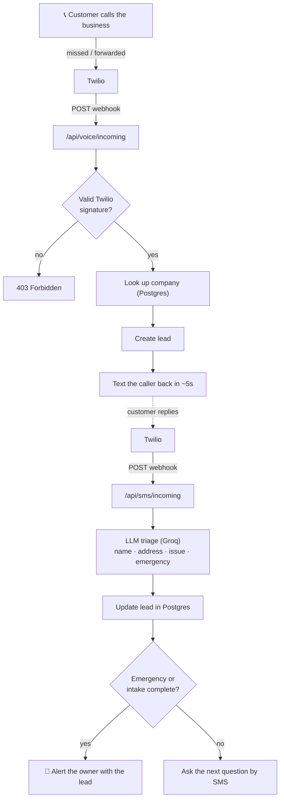

# CallCatch — Missed-Call Text-Back + AI Triage

When a business misses a phone call, the caller usually just dials a competitor.
**CallCatch** catches them: the moment a call is missed, it texts the caller back
within ~5 seconds, uses an LLM to collect their details and judge urgency, and
sends the business owner a ready-to-act lead — all on the business's existing
number, nothing to install.

Built for home-service businesses (plumbers, HVAC, electricians) and front desks.

🔗 **Live:** https://getcallcatch.vercel.app

---

## What it does

- **Instant text-back** — a missed/forwarded call triggers an automatic SMS to the caller in seconds.
- **AI intake** — an LLM reads the customer's replies and extracts name, address, and issue into a strict JSON shape.
- **Emergency detection** — flooding, burst pipes, gas smell, etc. are flagged (regex net + model signal) and the owner is alerted immediately.
- **Lead delivery** — the owner gets a clean SMS summary ("NEW LEAD — EMERGENCY, call back …").
- **Runs on the existing number** — via carrier call-forwarding; no app, no new line for customers.

## Tech stack

| Layer | Choice |
|---|---|
| Frontend + API | Next.js (App Router) · TypeScript · React |
| Telephony / SMS | Twilio (voice & messaging webhooks, `<Dial>` forwarding) |
| AI triage | LLM via the Groq API (OpenAI-compatible), strict JSON output |
| Database | Supabase (Postgres) |
| Hosting | Vercel (serverless functions + a daily cron health check) |
| Tests | Vitest |

## Architecture



## Notable engineering details

- **Webhook security** — every Twilio webhook is verified with an HMAC-SHA1
  signature check ([`lib/twilioSignature.ts`](lib/twilioSignature.ts)); a missing
  or bad signature returns `403` before any work is done.
- **Idempotency** — Twilio retries webhooks, so leads and messages are
  de-duplicated on `CallSid` / `MessageSid`.
- **Resilient AI** — the LLM is held to a strict JSON contract, the parser
  validates the shape, and there's a safe fallback reply if the model fails or
  returns malformed output. Emergencies get a fixed, safe reply (never an
  AI-generated promise of a callback time or price).
- **Mock mode** — `MOCK_TWILIO=true` logs outbound SMS to the console instead of
  sending, so the whole flow runs locally with no Twilio account.

## Local setup

```bash
npm install
cp .env.local.example .env.local   # fill in Supabase + Groq (+ Twilio for live mode)
npm run dev                         # http://localhost:3000
```

Environment variables (see [`.env.local.example`](.env.local.example)):
`SUPABASE_URL`, `SUPABASE_SERVICE_ROLE_KEY`, `GROQ_API_KEY`, `MOCK_TWILIO`,
and for live mode `TWILIO_ACCOUNT_SID`, `TWILIO_AUTH_TOKEN`, `TWILIO_WEBHOOK_BASE_URL`.

The database schema and a seed company are in [`db/schema.sql`](db/schema.sql).

## Tests

```bash
npm test          # Vitest — signature validation, triage parsing, route logic
npx tsc --noEmit  # type check
```

---

*Built as a solo full-stack project — design, implementation, deployment, and
go-to-market. MVP; not affiliated with any real business named in seed data.*
